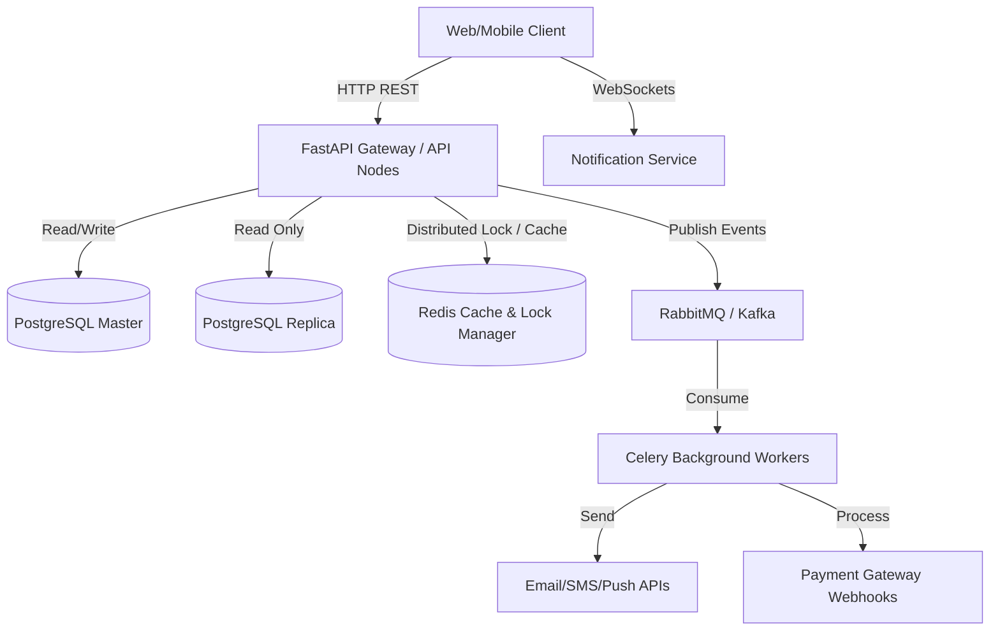
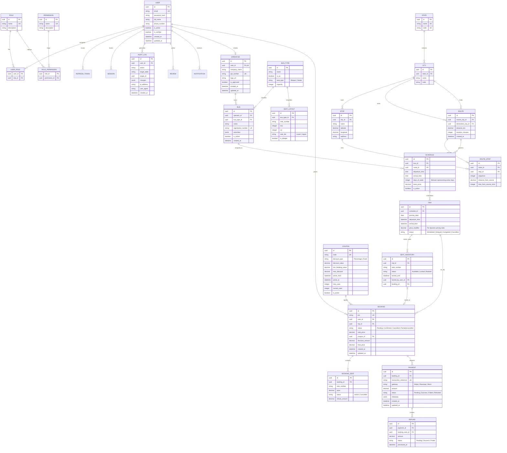

# Bus Ticket Booking System: Phase 1 Architecture & Design Specification

This document details the architectural design, database schema, folder structure, API specifications, and design decisions for the production-grade, high-scale Bus Ticket Booking System.

---

## 1. Architectural Overview

To support 100,000+ concurrent users and thousands of bookings per minute, the system is designed using a **Clean Architecture** combined with the **Repository & Unit of Work Patterns** and a decoupled **Event-Driven Architecture**.



### Key Architectural Patterns
* **FastAPI**: Asynchronous, high-performance web framework. Utilizing `async/await` throughout to prevent blockages on I/O operations (DB, Redis, HTTP requests).
* **Repository Pattern**: Abstracts data access details, allowing service layers to interact with domain models without database implementation details.
* **Unit of Work (UOW)**: Coordinates transactions across multiple repositories. Ensures atomic database writes, which is critical for the booking and payment flows.
* **CQRS (Command Query Responsibility Segregation) Principle**: Reading data (search, view trips) is separated from writing data (booking, payments). Fast paths bypass heavy logic and read from Redis caches or read-replicas.
* **Distributed Locking (Redlock)**: Implemented using Redis to manage seat locks during the booking window, guaranteeing no double-bookings occur even under high concurrency.
* **Outbox Pattern / Event-Driven Architecture**: Booking and cancellation events are pushed to RabbitMQ/Kafka, allowing background workers to process notifications, analytics, and third-party integrations asynchronously.

---

## 2. Folder Structure

We will adhere to a clean, domain-driven structure that scales cleanly as new domains are added:

```
backend/
│
├── app/
│   ├── api/
│   │   ├── deps.py               # Shared API dependencies (Auth, DB, Redis sessions)
│   │   └── v1/                   # API versioning root
│   │       ├── router.py         # Main API router merging all sub-routers
│   │       ├── auth.py
│   │       ├── users.py
│   │       ├── operators.py
│   │       ├── buses.py
│   │       ├── routes.py
│   │       ├── schedules.py
│   │       ├── trips.py
│   │       ├── seats.py
│   │       ├── bookings.py
│   │       ├── payments.py
│   │       ├── notifications.py
│   │       ├── coupons.py
│   │       ├── reviews.py
│   │       ├── admin.py
│   │       └── analytics.py
│   │
│   ├── core/                     # Application configurations and security
│   │   ├── config.py             # Pydantic BaseSettings class
│   │   ├── security.py           # JWT token generation, hashing
│   │   ├── exceptions.py         # Custom HTTP and Domain exceptions
│   │   ├── database.py           # SQLAlchemy engine, AsyncSession sessionmaker
│   │   ├── redis.py              # Redis client initialization and helpers
│   │   └── logging.py            # Structured logging setup
│   │
│   ├── middleware/               # Global middleware
│   │   ├── rate_limit.py         # Redis-based token-bucket rate limiter
│   │   ├── request_log.py        # Structured request/response logger
│   │   └── cors.py               # CORS setup
│   │
│   ├── models/                   # SQLAlchemy declarative models
│   │   ├── base.py               # Base class with common fields (id, created_at, etc.)
│   │   ├── auth.py               # Roles, Permissions, RefreshTokens, Sessions
│   │   ├── user.py               # Users, Profiles
│   │   ├── operator.py           # Operators
│   │   ├── bus.py                # Buses, BusTypes, SeatLayouts
│   │   ├── route.py              # Routes, Cities, States, Stops, RouteStops
│   │   ├── trip.py               # Schedules, Trips
│   │   ├── seat.py               # SeatInventory
│   │   ├── booking.py            # Bookings, BookingSeats
│   │   ├── payment.py            # Payments, Refunds
│   │   ├── marketing.py          # Coupons, Offers
│   │   ├── interaction.py        # Reviews
│   │   └── audit.py              # AuditLogs, Notifications
│   │
│   ├── schemas/                  # Pydantic request/response schemas
│   │   ├── auth.py
│   │   ├── user.py
│   │   ├── bus.py
│   │   ├── route.py
│   │   ├── trip.py
│   │   ├── booking.py
│   │   ├── payment.py
│   │   └── admin.py
│   │
│   ├── repositories/             # Database access classes
│   │   ├── base.py               # Generic CRUD AsyncRepository
│   │   ├── user.py
│   │   ├── bus.py
│   │   ├── route.py
│   │   ├── trip.py
│   │   ├── booking.py
│   │   └── payment.py
│   │
│   ├── services/                 # Business logic implementation
│   │   ├── auth.py
│   │   ├── user.py
│   │   ├── search.py             # Optimized bus search with Redis caching
│   │   ├── seat_lock.py          # Redis-based distributed seat locking logic
│   │   ├── booking.py            # Transactional booking & seat releases
│   │   ├── payment.py            # Mock gateway integrations and webhook handling
│   │   └── refund.py             # Cancellation and automatic refunds
│   │
│   ├── workers/                  # Celery background tasks
│   │   ├── celery_app.py         # Celery configuration
│   │   ├── tasks_notification.py # Email/SMS/Push notifications
│   │   └── tasks_cleanup.py      # Scheduled task to release expired locks from DB
│   │
│   └── tests/                    # Pytest test suite
│       ├── conftest.py
│       ├── test_auth.py
│       ├── test_search.py
│       └── test_booking.py
│
├── migrations/                   # Alembic migration files
│   ├── env.py
│   └── script.py.mako
│
├── docker/
│   ├── db-init.sql
│   └── redis.conf
│
├── scripts/
│   ├── wait-for-services.sh
│   └── run-tests.sh
│
├── .env.example
├── docker-compose.yml
├── Dockerfile
└── README.md
```

---

## 3. Database Schema

The relational database schema is designed to ensure strict referential integrity, performant querying using composite indexes, and structured normalization.



### Optimization Indexes
To ensure sub-200ms searches and rapid booking resolutions, we will apply these database indexes:
1. `idx_trip_search`: Composite index on `TRIP (journey_date, status)` + FK joins.
2. `idx_route_source_dest`: Composite index on `ROUTE (source_city_id, destination_city_id)`.
3. `idx_seat_inventory_trip_status`: Composite index on `SEAT_INVENTORY (trip_id, status, locked_until)`.
4. `idx_booking_pnr`: Unique B-Tree index on `BOOKING (pnr)`.
5. `idx_route_stop_seq`: Composite index on `ROUTE_STOP (route_id, sequence)`.

---

## 4. REST API Design Specifications

### Authentication & Users
* `POST /api/v1/auth/register` - Register a new customer or bus operator.
* `POST /api/v1/auth/login` - Authenticate credentials and get Access & Refresh JWTs.
* `POST /api/v1/auth/refresh` - Refresh access token using rotation strategies.
* `POST /api/v1/auth/logout` - Revoke current refresh token.
* `POST /api/v1/auth/reset-password-request` - Send password reset email link.
* `POST /api/v1/auth/reset-password` - Update password using reset token.
* `GET /api/v1/users/me` - Fetch profile details.
* `PATCH /api/v1/users/me` - Update profile data.

### Bus Operator Management
* `POST /api/v1/operators/register` - Onboard a user as an Operator (requires approval).
* `POST /api/v1/operators/buses` - Create a bus profile and seat configurations.
* `PUT /api/v1/operators/buses/{id}` - Update bus metadata or disable it.
* `POST /api/v1/operators/routes` - Establish source-destination routes.
* `POST /api/v1/operators/schedules` - Define schedules (recurrence, times, base prices).
* `POST /api/v1/operators/trips` - Generate concrete trips from schedules.

### Search Engine
* `GET /api/v1/trips/search` - Search available trips.
  * *Parameters:* `source_city_id`, `destination_city_id`, `date`, `seat_type`, `ac_only`, `price_min`, `price_max`, `operator_id`, `sort_by=price|departure|duration`, `limit`, `offset`.

### Real-Time Seat Locking & Bookings
* `GET /api/v1/trips/{trip_id}/seats` - Fetch real-time seat matrix with availability.
* `POST /api/v1/bookings/lock` - Lock selected seats for 5 minutes.
  * *Body:* `{ "trip_id": "uuid", "seats": ["1A", "1B"] }`
  * *Returns:* `{ "lock_token": "uuid", "expires_at": "datetime", "total_price": 2400.00 }`
* `POST /api/v1/bookings/create` - Place transactional booking using a lock token.
  * *Body:* `{ "lock_token": "uuid", "passenger_details": [...], "coupon_code": "DISCOUNT10" }`
  * *Returns:* PNR and temporary payment reference.
* `POST /api/v1/payments/pay` - Trigger mock payment (simulate processing).
* `POST /api/v1/payments/webhook` - Async gateway callback confirming status (Success/Failure) to confirm/release booking.
* `POST /api/v1/bookings/{booking_id}/cancel` - Cancel entire booking or partial seat lists, initiating refund workflows.

---

## 5. Design Decisions & High-Scale Strategies

### Strategy 1: The Booking Lock Lifecycle
1. **Request to Lock (Redis Lock + DB State)**:
   * Client calls `/api/v1/bookings/lock` for `trip_id` and seat list.
   * We acquire a Redis distributed lock for that specific trip resource to prevent concurrent writes on the seat layout.
   * Check if any seat is already `Booked` or `Locked` (where `locked_until > now`).
   * If available, insert/update the state in `SEAT_INVENTORY` to `Locked`, setting `locked_until = now + 5 minutes`, referencing the user's ID.
   * Release Redis lock.
   * Return a `lock_token` (derived from booking or cached session) and the expiry time.
2. **Transaction Resolution**:
   * To complete the booking, `/api/v1/bookings/create` must be called with the valid token.
   * If payment succeeds (or webhook matches), the seats are transitioned to `Booked` permanently, and the PNR is generated.
   * If the lock expires without a booking/payment confirmation, a background Celery worker sweeps expired locks (`locked_until < now` and status `Locked`) and resets them to `Available`.

### Strategy 2: Handling Concurrency and Double Bookings
* We will use **Optimistic Locking** on inventory rows (using a version/updated_at check) and back it with a **Pessimistic Write Lock (`SELECT FOR UPDATE`)** inside the database transaction block when updating seat status.
* A **Redis Distributed Lock (Redlock)** wrapper around critical operations ensures that identical duplicate booking requests hit Redis first, protecting the PostgreSQL connection pool.

### Strategy 3: Fast Bus Search (Sub-200ms)
* Trip details (buses, route stops, and operator metadata) change infrequently. Search responses are cached in Redis using key formatting: `search:{source_city_id}:{dest_city_id}:{date}`.
* Caches are set with a TTL (e.g., 2 minutes) to ensure price adjustments or last-minute cancellations propagate.
* When booking confirm requests happen, the specific trip's cache is invalidated or updated, ensuring seat counts are correct.

---

## 6. Next Steps (Phase 2 & Phase 3)
1. **Base Project Setup**: Docker files, `docker-compose.yml`, Poetry/Pip dependency manifest, Alembic configurations.
2. **Auth & User Module**: Fast API routing, User registrations, JWT tokens with verification middleware, RBAC enforcement.
3. **Database Migration Pipeline**: Core migrations matching the schema designed above.
